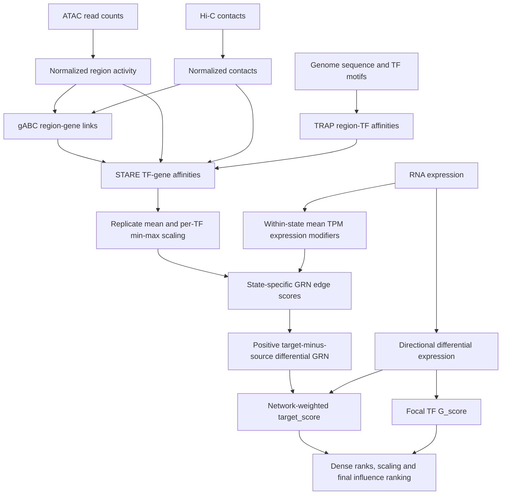

# Explanation of TF–gene affinities, binding probabilities and final ranking scores in the STARE + ANANSE workflow

This document explains how accessible chromatin, TF motifs, chromatin contacts and RNA expression contribute to the scores in `phd_stare_plus_ananse_workflow`. It describes the STARE 1.0.5 and ANANSE 0.5.1 implementations used in this reconstruction, including the custom conversion between them. The examples are hypothetical: they explain the equations and do not report measured contributions for the HSC dataset.

The main method uses RNA TPM from the same cell state as each GRN. State-specific selection is implemented in [select_state_tpm.py](../bin/select_state_tpm.py) and called before network conversion. The explicit `historical_pooled` option retains the former expression convention for historical reproduction; `state_specific` is the current default. Existing historical runs retain their original provenance. The historical exception and its source snippet are recorded in the [historical label and identity notes](LABEL_IDENTITY_AUDIT_v01.md#historical-tpm-state-selection-l12). Alternative edge formulas and influence-component weights are discussed in [Alternative ways of calculating “prob” edge weights and TF influence components](ALTERNATIVE_PROB_EDGE_WEIGHTS_AND_TF_INFLUENCE_COMPONENTS.md).

The workflow asks which TFs have a regulatory network that gains support in a **target cell state relative to a source cell state**, and whether the genes in that network change expression. A highly ranked TF may be a useful perturbation candidate even when its own expression change is small or not statistically significant. Conversely, a strongly induced TF can rank highly despite weak network support. The component scores distinguish these explanations.

## 1. The information passes through several different scores

| Stage | Quantity | Information that enters it | Interpretation |
|---|---|---|---|
| Accessible regions | Normalized ATAC activity, $A_r$ | Read overlaps in accessible regions, library totals and loess offsets | An activity proxy for regulatory region $r$ |
| Region–TF association | TRAP motif affinity, $M_{r,f}$ | Reference sequence and the TF's position-specific energy matrix | Predicted sequence affinity of TF $f$ for region $r$ |
| Region–gene association | gABC score | ATAC activity, normalized Hi-C contacts, candidate regions and annotated TSSs | Relative support for linking a regulatory region to a gene |
| Gene–TF association | STARE TF–gene affinity, $F_{f,g}$ | Motif affinity combined with promoter activity or contact-adjusted distal activity | Aggregate regulatory support for TF $f$ acting on gene $g$ |
| Relative binding profile | Scaled binding, $B_{f,g}$ | Replicate-averaged STARE affinities, min–max scaled separately for each TF | A gene's relative position in that TF's affinity profile |
| GRN edge | Custom network `prob`, $P_{f,g}$ | Scaled binding and scaled within-state mean TF and target-gene TPM | An expression-modulated regulatory edge score |
| Differential GRN edge | Positive target-minus-source edge weight, $\Delta P_{f,g}$ | The two state-specific GRNs | Regulatory support gained in the target state |
| Network-associated TF score | `target_score` | Differential-edge paths and significant absolute target-gene logFC | How strongly the TF's gaining network connects to changing genes |
| TF expression score | `G_score` | The focal TF's significant absolute logFC | Support from the TF's own differential expression |
| Final ranking score | `influence_score` | Dense ranks and scaling of `target_score` and `G_score` | The TF's relative priority within the scored candidate set |

These quantities should not all be called “binding probability.” In particular, the custom `prob` is bounded between zero and one, but it has not been calibrated as the probability that a TF physically binds or regulates a particular gene. It replaces ANANSE's usual binding/network construction; ANANSE's influence module consumes the resulting scores.



## 2. ATAC, motif affinity and Hi-C contribute to different parts of STARE

### 2.1 Accessibility supplies activity; motif sequence supplies TF specificity

ATAC read overlaps are normalized using `csaw::normOffsets()` and converted to linear CPM-like activities with offsets. The supplied signal is therefore normalized activity, rather than the unprocessed number of ATAC reads.

```r
se <- normOffsets(se)
cpm_mat <- calculateCPM(
    se,
    use.offsets = TRUE,
    use.norm.factors = FALSE,
    log = FALSE,
    assay.id = "counts"
)
```

See [normalize_atac.R](../bin/normalize_atac.R).

TRAP uses the DNA sequence and TF motif energy matrices to calculate region-level affinities. It retains graded sequence-affinity information rather than applying a binary motif-present/motif-absent rule. The presence, strength and multiplicity of motif-compatible sequence contribute to this affinity. This is different from a motif-enrichment test, which asks whether motifs occur disproportionately in a selected region set. See the [STARE TRAP implementation](https://github.com/SchulzLab/STARE/blob/v1.0.5/Code/TRAPmulti.cpp).

With the same reference genome, motif collection and union of candidate regions, those region-level motif affinities are shared between states. State differences arise from the activity/contact context and the expression information, rather than a change in motif sequence.

### 2.2 Hi-C helps allocate a region's activity to candidate genes

Let $C_{r,t}$ denote the effective contact between region $r$ and TSS $t$, including the contact processing and pseudocounts used by STARE. Let $S_r$ be the sum of the contacts used to allocate that region's activity across candidate TSSs. The contact-adjusted activity is:

$$
a_{r,t}=A_r\frac{C_{r,t}}{S_r}.
$$

The gABC score sums activity–contact products over the annotated TSSs of a gene and normalizes against the candidate regions for that gene:

$$
gABC_{r,g}=
\frac{\sum_{t\in TSS_g}a_{r,t}C_{r,t}}
     {\sum_{i\in R_g}\sum_{t\in TSS_g}a_{i,t}C_{i,t}}.
$$

Thus gABC is relative support for a region–gene link. It accounts for competing regions around a gene and competing candidate targets of a region. A region can be highly accessible yet contribute little to a particular gene if most of its contact support goes elsewhere. These relationships follow the gABC formulation in [Hecker et al., 2023](https://doi.org/10.1093/bioinformatics/btad062).

In the study configuration, STARE uses `all_tss`, contact pseudocounts, a gABC cutoff of 0.02 and 5-Mbp gene/enhancer windows. The shell window arguments specify total spans; these are not 5 Mbp on each side. A 100-kbp Hi-C bin size supplies relatively coarse contact information compared with the ATAC regions. These are configurable inputs, not universal biological constants.

### 2.3 The TF–gene affinity is not simply motif affinity multiplied by the gABC score

gABC selects distal region–gene associations. The TF–gene summarization then uses the motif affinity and an activity multiplier. A compact representation is:

$$
F_{f,g}=\sum_{r\in\mathcal R_g}
\frac{M_{r,f}}{\ell_f}V_{r,g},
$$

where $\ell_f$ is motif length. In ABC mode the multiplier is:

$$
V_{r,g}=\begin{cases}
A_r\exp(-d_{r,g}/5000), & d_{r,g}\le2500\ \mathrm{bp},\\
\overline a_{r,g}, & \text{linked distal region},\\
0, & \text{unlinked distal region}.
\end{cases}
$$

Here $\overline a_{r,g}$ is the contact-adjusted activity averaged over the gene's TSSs, as written to the ABC output's `intergenicScore` column when adapted ABC is enabled. The affinity scorer reads that column. Promoter-range regions are added independently of the distal gABC cutoff; their affinity multiplier uses base activity and distance decay. See the release-specific [ABC scorer](https://github.com/SchulzLab/STARE/blob/v1.0.5/Code/STARE_ABCpp.cpp) and [TF–gene scorer](https://github.com/SchulzLab/STARE/blob/v1.0.5/Code/TF_Gene_Scorer_Reshape.cpp).

The core accumulation in the TF–gene scorer is:

```cpp
these_gene_affinities[c][i] +=
    (region_info[0][i] / motif_lengths[i]) * affinity_scalers[c];
```

An accessible region with poor motif affinity contributes little for that TF. A strong motif in a weakly active region also contributes little. For distal regions, the contact allocation and link-selection step add another requirement. Strong evidence in only one modality need not produce strong TF–gene support.

### 2.4 Illustrative 100-point sensitivities for affinity contributions

The following table describes **local proportional sensitivity of a single affinity contribution**, before gene summation, replicate averaging and min–max scaling. It is not a variance decomposition, empirical dataset attribution or set of algorithm coefficients.

For a one-TSS distal example, write $V=Aq$, where $q=C/S$ is that target's effective contact share. Hold motif length, other contacts, link selection and upstream normalization fixed. Proportional sensitivities to motif affinity, activity and the effective contact $C$ are then:

$$
e_M=1,\qquad e_A=1,\qquad e_C=1-q.
$$

Each displayed score is $100e_i/\sum e_i$. The contact share changes when its numerator changes, so Hi-C has sensitivity $1-q$, not simply one. Values are rounded.

| Illustrative situation | ATAC activity | Motif affinity | Hi-C contact | Explanation |
|---|---:|---:|---:|---|
| Promoter-range contribution | 50.0 | 50.0 | 0.0 | The direct multiplier uses activity and distance decay, not contact allocation. |
| Distal link; contact share $q=0.01$ | 33.4 | 33.4 | 33.1 | A small-share target remains sensitive to a proportional increase in its contact. |
| Distal link; $q=0.10$ | 34.5 | 34.5 | 31.0 | Activity and motif affinity have slightly greater local sensitivity. |
| Distal link; $q=0.50$ | 40.0 | 40.0 | 20.0 | Increasing contact also increases the allocation denominator. |
| Distal link; $q=0.90$ | 47.6 | 47.6 | 4.8 | The target already receives most of the available contact allocation. |
| Limiting case: the sole contact allocation, $q=1$ | 50.0 | 50.0 | 0.0 | Further proportional contact increases do not change its share. |

The last row concerns the affinity multiplier with the link fixed. Contact can still affect gABC selection. Even a small Hi-C change can have a large effect if it moves a distal link across the cutoff; the resulting discontinuity is not represented by a local sensitivity table. Conversely, multiplying all contacts in an allocation by the same factor leaves their relative shares unchanged, subject to pseudocount and processing effects.

For multiple TSSs or many contributing regions, individual sensitivities combine according to their contributions. Raw Hi-C count changes also pass through normalization and pseudocounts. There is therefore no single ATAC/motif/Hi-C percentage split for the final gene affinity or scaled binding value.

## 3. Replicate averaging and binding scaling change the interpretation

The converter aligns gene and TF identities, intersects them across the supplied replicates, and averages their affinities. For each TF separately, it scales the resulting gene profile:

$$
B_{f,g}=\frac{\overline F_{f,g}-\min_j\overline F_{f,j}}
                    {\max_j\overline F_{f,j}-\min_j\overline F_{f,j}}.
$$

The converter excludes the helper columns `NumPeaks`, `AvgPeakDistance` and `AvgPeakSize`; they are not additional weighted components. A constant affinity column is set to zero. Scaling occurs separately in each state. These are the relevant [converter](../historical/scripts/07_network_conversion/01_STARE_TF_Gene_Affinities_to_ananse_network.py) excerpts:

```python
mats = [d.loc[genes, tfs].to_numpy(dtype=float) for d in dfs]
avg = np.mean(mats, axis=0)

bind = stare_gene_tf.copy()
for tf in bind.columns:
    v = bind[tf].to_numpy(dtype=float)
    if np.max(v) > np.min(v):
        bind[tf] = minmax_scale(v, (0.0, 1.0))
    else:
        bind[tf] = 0.0
```

For example, affinities `[2, 4, 10]` become `[0, 0.25, 1]`. Affinities `[20, 40, 100]` produce exactly the same scaled values. A uniform increase in the entire TF affinity profile therefore does not increase its scaled binding profile. Likewise, motif-length division is a constant within a TF column and is removed by this subsequent scaling, although the underlying region-specific motif affinities still shape the profile.

This focuses the downstream comparison on **relative gene targeting**. It also loses absolute scale between TFs and states. A scaled value of one means “the strongest gene in this TF's supplied profile,” not “the strongest binding interaction in the experiment.” Min–max extrema and the included gene universe matter: changing them can change many scaled edges, and a small absolute range can be stretched to the full zero-to-one range.

## 4. RNA expression modulates the network edge score

### 4.1 The custom probability formula

For each cell state $s$, select only RNA samples whose samplesheet `assay` is `RNA` and whose `cell_state` is exactly $s$. Match their `sample_name` values to TPM column names, rather than relying on filename order or condition-specific naming. Average those biological replicate TPMs:

$$
\overline{TPM}^{\,s}_g=\frac{1}{n_s}\sum_{i\in RNA(s)}TPM_{g,i}.
$$

The source GRN uses the source-state mean vector; the target GRN uses the target-state mean vector. TFs and target genes are matched to the corresponding vector, then their expression is min–max scaled separately across the TF and target-gene sets within that state. Denote these scaled values by $T^s_f$ and $E^s_g$. The same edge formula is evaluated independently for each state:

$$
P^s_{f,g}=B^s_{f,g}(0.5+0.5T^s_f)(0.5+0.5E^s_g).
$$

The following conceptual selection describes the implemented adapter, which validates state/sample identities before applying the existing edge calculation:

```python
state_samples = samplesheet.loc[
    (samplesheet["assay"] == "RNA") &
    (samplesheet["cell_state"] == state), "sample_name"
].tolist()
# Require a nonempty, unique list and an exact match to TPM sample columns.
tpm_state = tpm_table.loc[:, state_samples].mean(axis=1)
# Match TF/target identities, then scale the two expression sets separately.
```

Suppressing the state superscript for a single network:

$$
P_{f,g}=B_{f,g}(0.5+0.5T_f)(0.5+0.5E_g).
$$

```python
gt = float(tgt_expr_s.get(gene, 0.0))
boost_target = 0.5 + 0.5 * gt

for tf, b in bind.loc[gene].to_dict().items():
    b = float(b)
    if b <= min_binding:
        continue
    te = float(tf_expr_s.get(tf, 0.0))
    prob = b * (0.5 + 0.5 * te) * boost_target
```

These are state-specific expression-availability modifiers, rather than logFC or DE-significance scores. Expression differences can therefore affect network edges in addition to the separate differential-expression contribution in influence ranking. The modifiers are derived from the unfiltered TPM table after state selection; the separately generated TF-filtered TPM files are not the expression input described here. Scaling within each state remains relative: a uniform proportional change across all its TFs or all its targets can disappear after min–max scaling. Matching the gene/TF universe and recording selected sample columns are necessary for interpretable comparisons.

Both expression multipliers lie between 0.5 and 1, so for a retained edge:

$$
0.25B_{f,g}\le P_{f,g}\le B_{f,g}.
$$

Binding zero removes an edge at the default `min_binding=0`; expression zero does not. A scaled expression value of zero can mean the lowest expression in the scaling universe or a missing value filled with zero, and need not mean that the measured TPM is exactly zero. Each expression modifier can change a fixed-binding score by up to twofold; together they can change it fourfold. Renaming genes to uppercase symbols subsequently retains the **maximum** probability when multiple edges collapse to the same TF–symbol pair.

### 4.2 More illustrative probability scenarios

For positive scaled inputs, the proportional sensitivities are:

$$
e_B=1,\qquad e_E=\frac{E}{1+E},\qquad e_T=\frac{T}{1+T}.
$$

Normalize them to 100 points as in the affinity table. Binding is held at $B=0.5$ for the numerical edge examples. At zero expression, the sensitivity shown is its continuous-limit value; a finite increase from zero can still change the score. The table describes sensitivity to **already-scaled inputs**, not directly to raw RNA counts or TPM while recomputing all extrema.

| Expression situation | Scaled TF $T$ | Scaled target $E$ | `prob` at $B=0.5$ | Binding points | Target-expression points | TF-expression points |
|---|---:|---:|---:|---:|---:|---:|
| Both at their expression floor | 0 | 0 | 0.12500 | 100.0 | 0.0 | 0.0 |
| Both low | 0.1 | 0.1 | 0.15125 | 84.6 | 7.7 | 7.7 |
| Both midrange | 0.5 | 0.5 | 0.28125 | 60.0 | 20.0 | 20.0 |
| Both at their expression maximum | 1 | 1 | 0.50000 | 50.0 | 25.0 | 25.0 |
| TF at floor; target at maximum | 0 | 1 | 0.25000 | 66.7 | 33.3 | 0.0 |
| TF at maximum; target at floor | 1 | 0 | 0.25000 | 66.7 | 0.0 | 33.3 |
| TF low; target maximal | 0.1 | 1 | 0.27500 | 62.9 | 31.4 | 5.7 |
| TF maximal; target low | 1 | 0.1 | 0.27500 | 62.9 | 5.7 | 31.4 |

Binding is the primary full-range multiplier in this formula, while the expression modifiers are bounded. This does not establish that binding explains a particular fraction of variation in a real network. An input with little variation cannot explain much variation, even when its formula sensitivity is large. Conversely, expression-dependent changes can alter which edges survive the top-edge selection step.

## 5. Comparing GRNs identifies support gained in the target state

ANANSE reads `prob` as the edge `weight`, keeps the top 100,000 edges in each state under the study setting, and subtracts source scores from target scores. It retains only positive differences:

```python
diff_network = target.join(
    source, lsuffix="_target", rsuffix="_source"
).fillna(0)
diff_network["weight"] = (
    diff_network["weight_target"] - diff_network["weight_source"]
)
diff_network = diff_network[diff_network["weight"] > 0]
```

See [influence.py](../historical/software/ananse/influence.py). Missing source edges after filtering are treated as zero; source-only edges are not retained in the positive target-centric differential graph. Top-edge selection precedes subtraction, so an edge excluded from the source's selected set can appear as a gain even if a weaker version existed in its full network.

A large absolute edge in both states is not necessarily influential: probabilities 0.90 and 0.92 yield a differential weight of only 0.02. Probabilities 0.10 and 0.60 yield 0.50. The latter supplies more weight to the gaining-network calculation despite its lower target-state absolute score.

With state-specific TPM, the unfiltered edge difference is:

$$
\Delta P_{f,g}=B^{target}_{f,g}(0.5+0.5T^{target}_f)(0.5+0.5E^{target}_g)
             -B^{source}_{f,g}(0.5+0.5T^{source}_f)(0.5+0.5E^{source}_g).
$$

Binding-profile changes and expression-availability changes can reinforce or offset one another. For example, doubling binding from 0.4 to 0.8 while target expression falls from 1 to 0, with TF expression fixed at 1, leaves both edge scores at 0.4. The target's repression can subsequently contribute through absolute DE only if a positive differential-network path reaches it; that DE score does not restore a discarded edge.

As a special case, if the scaled expression factors are identical between states, then:

$$
\Delta P_{f,g}=(0.5+0.5T_f)(0.5+0.5E_g)
              (B^{target}_{f,g}-B^{source}_{f,g})
$$

before edge filtering. Only in that special case do common expression factors attenuate or preserve binding-profile gains without encoding the expression transition. The factorization is not the general state-specific calculation. Directional RNA differential expression also enters separately in the influence step.

## 6. `target_score` combines network support with changing target genes

For each gene $j$, the expression-change score is:

$$
D_j=|\log_2FC_j|\,\mathbf1(padj_j<0.05).
$$

ANANSE uses absolute fold changes here, so both significantly increased and decreased target genes can contribute. The regulatory edges are unsigned: a positive differential edge means greater predicted regulatory support, not experimentally established activation rather than repression.

For a focal TF $f$, ANANSE constructs an outward ego subgraph with radius two and performs its probability/path-length search. A path of $L$ edges has the weight:

$$
W(p)=\frac{\prod_{e\in p}\Delta P_e}{L}.
$$

The selected path weight for each target is combined with its expression-change score:

$$
target\_score_f=\sum_j D_jW_{f,j}.
$$

```python
ts = 0
for target, weight in targets.items():
    g = expression_change[target].score
    ts += g * weight
```

A direct edge of 0.5 has path weight 0.5. Two edges of 0.8 and 0.6 have path weight $0.8\times0.6/2=0.24$. Two edges of 0.1 give only 0.005. Longer or weaker paths therefore supply less support. The implementation restricts the **nodes** to the two-hop ego subgraph; the subsequent path search does not explicitly cap path length at two edges. See [nx.py](../historical/software/ananse/nx.py).

`target_score` is high when a TF reaches many significantly changing genes through substantial differential-edge weights, or reaches fewer genes with particularly large expression changes. It can be low despite many outgoing edges if the targets do not change significantly, gains are weak, or available paths have small cumulative weights. It is not normalized by the number of targets, so network breadth can increase the raw sum. Neighbourhood counts describe that breadth but are not separately added to the final ranking.

| Illustrative target support | Target expression-change score | Path weight | Raw `target_score` |
|---|---:|---:|---:|
| 100 significant targets with strong direct gains | 2 each | 0.5 each | 100 |
| 10 significant targets with the same support | 2 each | 0.5 each | 10 |
| 100 significant targets connected by two weak 0.1 edges | 2 each | 0.005 each | 1 |
| 100 reachable targets, none significant | 0 each | Any positive weight | 0 |

These examples treat the targets as distinct contributors and hold the graph/path selection fixed. The cumulative network weights already include motif, accessibility, contact and mean-expression information through the edge construction.

## 7. `G_score` uses the focal TF's own differential expression

$$
G\_score_f=|\log_2FC_f|\,\mathbf1(padj_f<0.05).
$$

```python
df["fc"] = df["log2FoldChange"].abs()
df["score"] = df["fc"] * (df["padj"] < padj_cutoff)
```

A TF logFC of 4 with `padj=0.001` gives `G_score=4`; a logFC of 0.2 with `padj=0.2` gives zero. Absolute abundance and expression change are different: a highly expressed TF can have a small or non-significant change, while a less abundant TF can have a large fold change. The adjusted p-value is a threshold gate here, not a continuous multiplier: at the same logFC, `padj=0.001` and `padj=0.04` give the same expression-change score. Crossing 0.05 can change that score to zero.

**Eligibility is separate from significance.** In this implementation, scored TFs must have an outgoing edge in the differential graph, usable DE information and strictly positive directional logFC. A TF with a small, non-significant positive logFC remains eligible and can have `G_score=0`. A TF with exactly zero or negative directional logFC is excluded from that comparison; strong network support alone does not bypass this gate. Genes with unusable DE values are dropped during expression-data preparation.

High network support with little TF RNA change is consistent with a change in regulatory opportunity through chromatin accessibility or contacts. Protein abundance, post-translational modification, cofactors and localization are additional possible biological explanations, but this workflow does not directly measure them. Likewise, high TF differential expression with weak target support could reflect an indirect response or a passenger change rather than a causal regulator.

## 8. Raw influence and final ranking use different scales

### 8.1 Raw influence retains the magnitude imbalance

$$
influence\_score\_raw_f=target\_score_f+G\_score_f.
$$

The two inputs have equal additive coefficients, but their magnitudes are not comparable: one is a sum over a network and the other is a single TF's fold-change score. A large target sum can dominate this raw value.

### 8.2 Final ranking first replaces magnitudes with dense ranks

Within the scored candidate set, ANANSE assigns ascending **dense ranks** separately to `target_score` and `G_score`: tied values receive the same rank, and the next distinct value receives the next integer. It then min–max scales each set of ranks:

$$
R_T(f)=\operatorname{minmax}(\operatorname{denseRank}(target\_score_f)),
\qquad
R_G(f)=\operatorname{minmax}(\operatorname{denseRank}(G\_score_f)).
$$

For $K>1$ distinct values in a component, dense rank $r$ becomes $(r-1)/(K-1)$. If the component is constant, its scaled values are zero. The final operation ranks and scales the sum again:

$$
U_f=R_T(f)+R_G(f),\qquad
influence\_score_f=\operatorname{minmax}(\operatorname{denseRank}(U_f)).
$$

```python
df["target_score_scaled"] = minmax_scale(
    rankdata(df["target_score"], method="dense")
)
df["G_score_scaled"] = minmax_scale(
    rankdata(df["G_score"], method="dense")
)
df["influence_score_raw"] = df.target_score + df.G_score
df["influence_score"] = minmax_scale(
    rankdata(df.target_score_scaled + df.G_score_scaled, method="dense")
)
```

This is the archived [ANANSE 0.5.1 ranking code](../historical/software/ananse/influence.py), which matches the inspected conda environment. It follows the network-influence framework of [Xu et al., 2021](https://doi.org/10.1093/nar/gkab598); the custom edge construction described above is specific to this hybrid workflow.

### 8.3 A six-TF cohort illustrating strong, balanced and weak support

All six hypothetical TFs have outgoing differential edges, usable DE information and positive logFC. The scores are considered **together in one cohort**, because ranking examples cannot be interpreted independently of the other candidates.

| TF scenario | Biological/scoring situation | Raw `target_score` | TF logFC | TF `padj` | Raw `G_score` |
|---|---|---:|---:|---:|---:|
| Network-supported | 100 significant targets, each with $D=2$ and path weight 0.5; TF change is not significant | 100 | 0.2 | 0.2 | 0 |
| TF-expression-supported | Reachable targets do not change significantly; the TF is strongly induced | 0 | 4 | 0.001 | 4 |
| Supported by both | 80 targets with the same strong support; the TF is also strongly induced | 80 | 3 | 0.001 | 3 |
| Balanced midrange | 20 targets with $D=1$ and path weight 0.5; the TF has a moderate significant change | 10 | 1 | 0.01 | 1 |
| Both low | No significant target contribution; TF change is small and not significant | 0 | 0.05 | 0.5 | 0 |
| Weak in both | Small network contribution and a small but significant TF change | 1 | 0.1 | 0.01 | 0.1 |

The distinct target scores are `[0, 1, 10, 80, 100]`; the distinct TF expression scores are `[0, 0.1, 1, 3, 4]`. Both therefore have five dense-rank levels. Applying the actual sequence of operations gives:

| TF scenario | Raw influence | `target_score_scaled` | `G_score_scaled` | Component sum $U$ | Final `influence_score` |
|---|---:|---:|---:|---:|---:|
| Network-supported | 100 | 1.00 | 0.00 | 1.00 | 0.667 |
| TF-expression-supported | 4 | 0.00 | 1.00 | 1.00 | 0.667 |
| Supported by both | 83 | 0.75 | 0.75 | 1.50 | 1.000 |
| Balanced midrange | 11 | 0.50 | 0.50 | 1.00 | 0.667 |
| Both low | 0 | 0.00 | 0.00 | 0.00 | 0.000 |
| Weak in both | 1.1 | 0.25 | 0.25 | 0.50 | 0.333 |

The final distinct sums are `[0, 0.5, 1, 1.5]`; their dense ranks scale to `[0, 1/3, 2/3, 1]`. The TF supported by both components ranks first. Network-supported, TF-expression-supported and balanced-midrange candidates tie for second, despite very different raw magnitudes and biological explanations.

This demonstrates why a TF with **zero `G_score`** can rank highly, and why one with **zero `target_score`** can also rank highly. It also shows that moderate support in both components can equal maximal support in only one. The largest raw target sum need not identify the highest final-ranked TF.

### 8.4 What a 100-point interpretation can and cannot mean at this stage

The final component sum has equal coefficients. Expressed as a nominal budget, the two branches receive 50 points each:

| Final-ranking branch | Nominal coefficient budget | Ingredients inside the branch |
|---|---:|---|
| Scaled rank of `target_score` | 50 | Cumulative differential-network support multiplied by target-gene differential expression; network scores already contain motif, ATAC, Hi-C and mean-TPM modifiers |
| Scaled rank of `G_score` | 50 | The focal TF's significant expression change |

There is no implemented fixed subdivision of the first 50 into binding, target TPM, target logFC and TF TPM. They interact inside the network/path calculation. The focal TF's RNA information can also contribute indirectly through network edges, in addition to its direct `G_score` contribution.

For the hypothetical cohort, the realized fraction of $U$ supplied by each **scaled component** is:

| Scenario | Network/target-DE component points | Focal TF-DE component points |
|---|---:|---:|
| Network-supported | 100 | 0 |
| TF-expression-supported | 0 | 100 |
| Supported by both | 50 | 50 |
| Balanced midrange | 50 | 50 |
| Both low | Undefined: both components are zero | Undefined: both components are zero |
| Weak in both | 50 | 50 |

These are component-sum shares, not the earlier local sensitivities and not causal contributions to rank. “100 network points” still includes expression information within the network/target-DE branch. Equal 50/50 shares can accompany either a high or a low final score, as the supported-by-both and weak-in-both rows demonstrate.

### 8.5 Consequences of rank scaling

* **Magnitude gaps are removed.** A raw target score of 100 receives only one rank step more than 80 in this example. Making 100 into 1,000 changes neither its component rank nor the final ranking if the ordering remains unchanged.
* **Network and TF-expression ordering receive equal nominal weight.** Their original numerical units and ranges no longer determine which branch dominates.
* **Dense ranks are not percentiles of TF counts.** They depend on the number of distinct score values. Many TFs tied at `G_score=0` share the lowest level; a small significant score can receive a substantial scaled rank if few distinct levels exist.
* **A constant component contributes no discrimination.** If every TF has zero `G_score`, its scaled component is zero and the network component determines the ranking. If every `target_score` is equal, TF expression determines the ranking. If both are constant, all final scores are zero and tied.
* **Scores are cohort-relative.** Adding/removing candidates can change the dense-rank spacing and final ordering. A final score of one means highest priority in this run, not certain causality or a universally comparable effect size.
* **The last rank transform preserves the ordering of $U$ but removes its gaps.** For example, distinct sums `[0, 0.1, 1, 1.8]` become scores `[0, 1/3, 2/3, 1]`. It is not an additional biological weighting operation. Equal sums remain tied; incidental row order among tied TFs should not be interpreted as biological preference.

## 9. When each modality has more or less influence

| Information | Situations in which it has stronger influence | Situations in which it has weaker influence or is insufficient alone |
|---|---|---|
| ATAC accessibility | Activity redistributes among motif-containing regions connected to particular genes; it creates a distinct relative TF–gene profile or moves links across the gABC cutoff | A uniform change across the whole affinity profile can disappear after min–max scaling; accessible regions with poor motif affinity contribute little for that TF |
| Motif affinity | Strong relative affinity occurs in regions with state-specific activity and plausible target links, making the pattern TF-specific | Motifs lie in weakly active regions, unsupported distal regions, or equally supported regions in both states; related TFs can share similar motifs |
| Hi-C contacts | Contact allocation supports distal targets, redistributes activity among genes, or changes which links pass the cutoff | Promoter affinity multipliers do not directly use contacts; contact shares near saturation respond little to further proportional increases; coarse bins do not resolve individual regulatory interactions |
| Target within-state mean RNA expression | Targets lie near the upper expression scaling range; a change in their relative expression reinforces or offsets binding gains and changes retained edges | The modifier remains at least 0.5 at its floor; uniform expression changes can disappear after scaling, and repression can counteract a binding gain |
| TF within-state mean RNA expression | The TF is near the upper scaled TPM range, preserving more binding-derived support; a change in its relative expression affects all its outgoing edges | Low scaled expression attenuates rather than eliminates an edge; RNA abundance does not directly measure protein activity |
| Target differential expression | Many reachable genes change significantly, or fewer targets have large changes and strong differential paths | Targets are non-significant or weakly connected; expression changes without gaining network support do not contribute through this branch |
| Focal TF differential expression | The TF is positively and significantly induced and ranks highly on `G_score` | Its positive change is non-significant, so direct `G_score` is zero; zero/negative logFC excludes it from this comparison altogether |

## 10. What GRN inference adds to traditional TF prioritization

Motif enrichment and TF differential expression answer useful but narrower questions. A GRN comparison additionally asks **which genes a TF could affect, through which regions, and whether those regulatory connections gain support in the relevant state transition**.

| Approach | Main question | Information supplied by the hybrid GRN analysis |
|---|---|---|
| Motif enrichment in selected accessible regions | Which motif families are overrepresented relative to a background? | Quantitative region activity and motif affinity, predicted gene links, contact context and target-expression changes |
| TF differential expression | Which TF transcripts increase or decrease, and with what statistical support? | Whether the TF's predicted gaining network connects to a broad or strong expression response; support can remain high when the TF's positive RNA change is non-significant |
| Differential GRN plus influence ranking | Which eligible TFs combine a gaining regulatory network with expression changes in themselves and/or their targets? | Component scores, direct and indirect targets, and traceable region–gene evidence that can inform perturbation selection |

For example, a motif family may be enriched in newly accessible regions but mainly in regions lacking convincing links to changing genes. A motif-only analysis would still nominate the family; the network-based target score may supply little support. Conversely, a TF may connect many gaining regulatory edges to significantly changing genes without a large significant change in its own transcript. The network branch can identify it as a candidate that a significance-only TF DE screen would miss, provided its directional logFC is positive.

The published ANANSE study evaluated regulatory-network and TF-prioritization performance using several benchmarks and supports the value of combining enhancer and expression information. Its binding/network construction differs from this custom STARE hybrid, so those results do not establish that the present workflow outperforms simpler methods on this dataset. [Xu et al., 2021](https://doi.org/10.1093/nar/gkab598).

The hybrid is therefore **more informative for mechanistic prioritization**, but its predictions still depend on the quality of inferred links, motif specificity, peak universes, normalization, DE estimates and score transformations. Mean-expression modifiers and DE scores also reuse RNA information at different stages; their apparent contributions are not statistically independent. Comparing its predictions against matched motif-enrichment and TF-DE baselines, followed by perturbation experiments, is needed to demonstrate improved prediction in the intended setting.

A high rank nominates a TF for investigation. It does not establish direct occupancy, activation/repression sign, an effective overexpression dose or that inhibiting the TF will reverse a cell state. Reversing source and target produces a different positive-gain network and a different set of positively expressed candidate TFs; it is not simply the negative of the forward ranking.

## 11. Using this explanation in slides, methods and algorithm development

For presentations, distinguish three levels: **region evidence → regulatory networks → transition-specific TF prioritization**. Label illustrative 100-point tables as local sensitivities or component-sum shares, rather than measured contributions. Present the two scaled ranking components alongside the final rank so that a network-supported candidate can be distinguished from an expression-supported candidate.

For methods sections, specify the peak universe, normalization, Hi-C resolution, STARE windows/cutoff and motif collection; state that replicate affinities are averaged and min–max scaled per TF; give the custom edge formula and within-state TPM selection/averaging convention; and report top-edge selection, target-minus-source subtraction, significant absolute target logFC, the positive TF-logFC eligibility gate and dense-rank scaling. Describe actual runs according to their recorded implementation, including historical exceptions. Calling the complete procedure “standard ANANSE network inference” would omit the custom STARE edge construction.

Possible future method comparisons include preserving absolute affinity information, replacing extrema-sensitive scaling, changing expression-modifier strength, testing alternative eligibility rules, normalizing for target-set size, resolving motif-family ambiguity, and estimating uncertainty in links and rankings. These are proposals for separately labelled methods, not changes implemented here. Empirical contribution estimates would require a defined perturbation/ablation analysis that recomputes the affected stages and reports both component-score and rank changes; the illustrative tables cannot substitute for that analysis.

## Implementation and reference links

* [ATAC normalization](../bin/normalize_atac.R).
* [STARE shell orchestration](../historical/scripts/06_stare/modified_STARE.sh).
* [STARE v1.0.5 ABC scorer](https://github.com/SchulzLab/STARE/blob/v1.0.5/Code/STARE_ABCpp.cpp) and [TF–gene affinity scorer](https://github.com/SchulzLab/STARE/blob/v1.0.5/Code/TF_Gene_Scorer_Reshape.cpp).
* [Custom STARE-to-ANANSE converter](../historical/scripts/07_network_conversion/01_STARE_TF_Gene_Affinities_to_ananse_network.py) and [symbol conversion](../historical/scripts/07_network_conversion/02_convert_ensembl_to_symbol.py).
* [Archived ANANSE influence implementation](../historical/software/ananse/influence.py) and [path-weight implementation](../historical/software/ananse/nx.py).
* Hecker et al. (2023), *The adapted Activity-By-Contact model for enhancer–gene assignment and its application to single-cell data*. [Bioinformatics, btad062](https://doi.org/10.1093/bioinformatics/btad062).
* Xu et al. (2021), *ANANSE: an enhancer network-based computational approach for predicting key transcription factors in cell fate determination*. [Nucleic Acids Research, gkab598](https://doi.org/10.1093/nar/gkab598).
